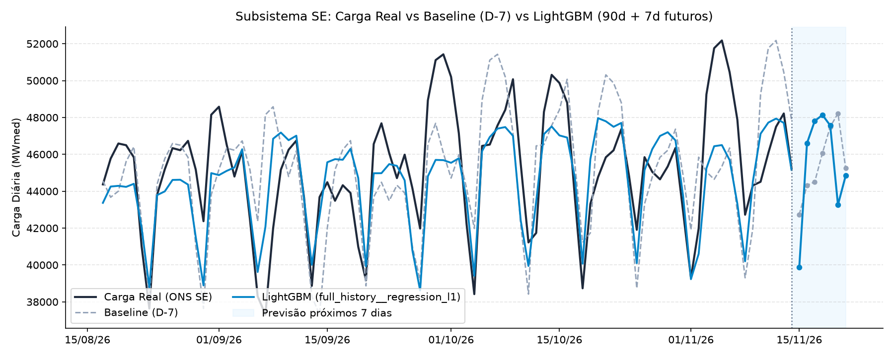
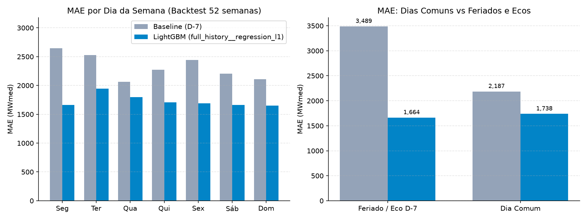

# Previsão de Carga de Energia (ONS - Subsistema SE)

Projeto de previsão da carga de energia diária (em MWmed) do subsistema Sudeste/Centro-Oeste (`SE`) para os próximos 7 dias, utilizando dados públicos do Operador Nacional do Sistema Elétrico (ONS).

## Pergunta do desafio

> O seu modelo prevê melhor do que simplesmente repetir o valor do mesmo dia da semana anterior? Se sim, quanto melhor?

**Sim.** No backtesting temporal com janela expansiva de **52 semanas (`364` dias, de 16/11/2025 a 14/11/2026)**, o modelo **LightGBM (`full_history__regression_l1`)** alcançou **MAE de `1.730,58` MWmed** e **MAPE de `3,891%`**, superando o baseline ingênuo (`D-7`: **MAE `2.322,70` MWmed** e **MAPE `5,225%`**). Isso representa uma **redução de `25,49%` no MAE** (`-592,12` MWmed e `-1,334 p.p.` no MAPE), com ganho ainda mais expressivo em feriados, vésperas, pós-feriados e ecos de `D-7` (**`-52,32%` no MAE**: `1.663,71` vs `3.489,13` MWmed).

## Resultados do Backtesting (52 semanas)

| Modelo | Dias | MAE (MWmed) | MAPE (%) | RMSE (MWmed) | Ganho MAE vs `D-7` |
|---|---:|---:|---:|---:|---:|
| **`LightGBM (full_history__regression_l1)`** | 364 | **1.730,58** | **3,891%** | **2.214,53** | **+25,49%** |
| `LightGBM (post_mmgd__regression)` | 364 | 1.780,97 | 4,001% | 2.280,39 | +23,32% |
| `LightGBM Global (SE/S/NE/N — recorte SE)` | 364 | 1.901,23 | 4,210% | 2.395,88 | +18,15% |
| `AutoETS (statsforecast)` | 364 | 1.920,73 | 4,314% | 2.498,07 | +17,31% |
| `Baseline (D-7)` | 364 | 2.322,70 | 5,225% | 2.893,26 | 0,00% |

| Subsistema (Modelo Global `LightGBM`) | Dias | MAE `Baseline D-7` | MAE Global | MAPE Global | Ganho MAE vs `D-7` |
|---|---:|---:|---:|---:|---:|
| `SE` (Sudeste/Centro-Oeste) | 364 | 2.322,70 | 1.901,23 | 4,210% | +18,15% |
| `S` (Sul) | 364 | 883,70 | 719,40 | 5,058% | +18,59% |
| `NE` (Nordeste) | 364 | 464,48 | 439,55 | 3,210% | +5,37% |
| `N` (Norte) | 364 | 251,56 | 217,99 | 2,526% | +13,34% |

| Tipo de Dia | Dias | MAE `Baseline D-7` | MAE `LightGBM` | Ganho no MAE |
|---|---:|---:|---:|---:|
| Feriado / Véspera / Pós / Eco `D-7` | 38 | 3.489,13 | **1.663,71** | **+52,32%** |
| Dia Comum | 326 | 2.186,74 | **1.738,37** | **+20,50%** |





## Etapas do projeto

- [x] **1. Ambiente**: Repositório inicializado com `pyproject.toml`, `.gitignore`, `uv` e `Docker`
- [x] **2. Ingestão (bronze)**: Dados de 2018 até hoje salvos em `data/bronze/*.parquet` via DuckDB `httpfs` sem alterações
- [x] **3. Transformação (silver e gold)**: Modelos dbt + DuckDB para os subsistemas e série do `SE`, com **24 testes** passando
- [x] **4. Baseline**: Previsão ingênua `D-7` em `pandas` (`src/baseline.py`)
- [x] **5. Modelo**: `LightGBM` com lags $\ge 7$ dias, calendário e feriados BR (`src/features.py` e `src/train.py`), registrado no `MLflow` (Docker)
- [x] **6. Avaliação**: Backtesting temporal de 52 semanas comparando modelo e baseline em MAE e MAPE (`src/evaluate.py`)
- [x] **Bônus implementados**:
  - Dashboard interativo em **Streamlit** (`src/app.py`)
  - Segundo concorrente estatístico (**`AutoETS` via `statsforecast`**, `src/statistical.py`)
  - Modelo global único para todos os subsistemas (**`SE`, `S`, `NE`, `N`** em `src/global_model.py`)
  - Pipeline rodando com um único comando (**`src/pipeline.py`**, **`Makefile`** e **Docker Compose**)
  - Lint e testes automatizados (**`ruff`** e **`pytest`**)

## Como rodar

### Execução completa em um único comando
Localmente (do Parquet bruto até todos os modelos e gráficos):
```bash
uv sync --all-groups
uv run python -m src.pipeline
```
Ou via `Makefile` / Docker Compose (subindo o MLflow e executando o container do pipeline):
```bash
wsl -e bash -lc "cd /mnt/c/previsso_de_carga_de_energia && docker compose up -d --wait mlflow && docker compose --profile pipeline run --rm --build pipeline"
```
E para abrir o dashboard Streamlit:
```bash
uv run streamlit run src/app.py
```

### Etapas individuais
1. **Ingestão (Bronze):** `uv run python -m src.ingest`
2. **Transformação (Silver e Gold + docs dbt):** `uv run python -m src.transform`
3. **Baseline (`D-7`):** `uv run python -m src.baseline`
4. **Treinamento `LightGBM` + `MLflow`:** `uv run python -m src.train`
5. **Backtesting 52 semanas e gráficos:** `uv run python -m src.evaluate`
6. **Concorrente estatístico (`AutoETS`):** `uv run python -m src.statistical`
7. **Modelo global (`SE`, `S`, `NE`, `N`):** `uv run python -m src.global_model`

### Lint e testes unitários
```bash
uv run ruff check .
uv run pytest -v
```

## O que faria com mais tempo

- **Variáveis meteorológicas exógenas (INMET):** incorporar temperatura e sensação térmica previstas para as principais capitais do `SE` (SP, RJ, MG), pois ondas de calor e frentes frias explicam boa parte dos picos residuais em dias comuns.
- **AutoARIMA e Ensemble:** incluir `AutoARIMA` ao lado do `AutoETS` e avaliar combinação (ensemble) com o `LightGBM` para estabilizar ainda mais os horizontes `h = 3..4`.
- **CI/CD no GitHub Actions:** executar `ruff check .` e `pytest -v` automaticamente a cada pull request.
